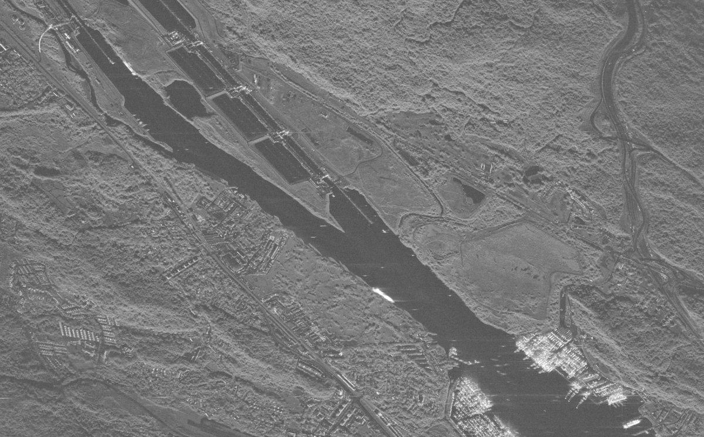
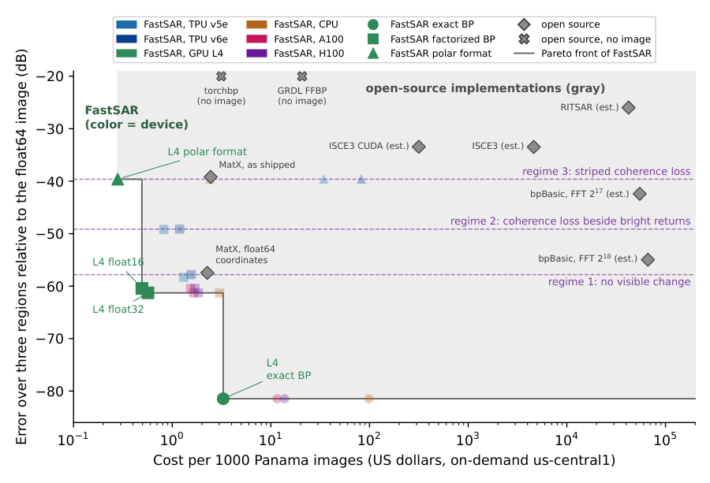

# FastSAR

[](https://github.com/saulpingerman/FastSAR/blob/main/LICENSE)
[](https://github.com/saulpingerman/FastSAR/blob/main/pyproject.toml)

FastSAR forms synthetic aperture radar (SAR) images on x86 and ARM CPUs, Nvidia GPUs and Google Cloud TPUs from
Python. It reads frequency-domain CPHD files (versions 1.0, 1.1 and 0.3) and NISAR, Sentinel-1 and ALOS PALSAR raw data, forms spotlight,
stripmap and sliding spotlight images by factorized backprojection, and provides autofocus, interferometry,
geolocation, map GeoTIFFs and SICD output.



*Panama Canal, Pacific entrance (Umbra open data, 2023-07-18): 12,207 by 8,808 pixels in 3.0 s on an Nvidia L4
(warm former, transfers included; float32, -59.9 dB against the float64 reference of
[precision.md](https://github.com/saulpingerman/FastSAR/blob/main/docs/precision.md)), downsampled. A
c4d-highmem-16 CPU instance (16 vCPUs, 8 cores) takes 11.2 s. The fastest open-source exact backprojection that forms this
collection, the `sar_bp` example of NVIDIA's MatX, takes 12.5 s on the L4 as shipped and 11.6 s with float64 pixel
coordinates, against 10.9 s for FastSAR's exact backprojection at the same accuracy; on the CPU, ISCE3 would take an
estimated 4.8 h.*



*Cost per 1000 Panama images (October 2026 prices) against error over the lock, port and ship regions (FastSAR relative to
a float64 backprojection at 64 times oversampling, the open-source codes to the float64 reference; [performance](https://github.com/saulpingerman/FastSAR/blob/main/docs/performance.md), [comparison](https://github.com/saulpingerman/FastSAR/blob/main/docs/comparison.md)).*

## Install

Linux on x86-64 or 64-bit ARM and macOS on Apple silicon, Python 3.10 to 3.13. The wheels for these platforms
carry the CPU kernels prebuilt, so the CPU backend needs no compiler: on x86-64 at three instruction-set levels
(x86-64-v2, x86-64-v3 with AVX2, x86-64-v4 with AVX-512), of which the best one the processor runs is loaded. Where
a C++ compiler is present the kernels are compiled on first use for the exact processor instead: `g++` with OpenMP
on Linux (GCC 12 or later on ARM; Debian and Ubuntu: `apt install g++`), Apple's clang on macOS (the command line
tools, `xcode-select --install`, which also serve the Metal backend of `ExactFormer` on Apple GPUs). An
installation from the source distribution has no prebuilt kernels and needs the compiler. The GPU backend needs an
Nvidia driver for CUDA 12 or later and the `tpu` extra a Cloud TPU VM.

```bash
pip install fastsar                  # CPU, Nvidia GPU, and the CPHD, SICD and SIDD files (no other package)
pip install "fastsar[tpu]"           # tpu: jax[tpu] for Cloud TPUs
pip install "fastsar[geo]"           # geo: rasterio for GeoTIFFs and DEMs
pip install "fastsar[raw]"           # raw: h5py for the NISAR raw reader
```

On Linux x86-64 the installation includes CuPy and the CUDA runtime libraries (about 2 GB), so a machine with an
Nvidia driver uses its GPU with no system CUDA toolkit; on other platforms `pip install "fastsar[cuda]"` adds
CuPy where its wheels exist. An environment that already holds another CuPy build should install FastSAR with
`--no-deps` and its dependencies by hand, since two CuPy wheels cannot share an environment.

What a machine needs beyond pip's packages depends on its hardware. After installing, `python -m fastsar.doctor`
reports which backends are ready (the CPU kernels in use, prebuilt or built by the C++ compiler; CuPy for the GPU's
CUDA version; the TPU build of JAX; the readers' packages) and prints the command that installs each missing piece;
`python -m fastsar.doctor --install` runs the pip commands among them.

From a clone: `pip install -e ".[cuda,io]"` or `uv sync`. The CUDA tensor-core kernels (float16, and float32 on compute capability 8.0 and later) need `nvcc` from the CUDA toolkit; without it float32 runs on the CUDA cores, more slowly. On the CPU set
`OMP_NUM_THREADS=<physical cores> OMP_PLACES=cores OMP_PROC_BIND=close` (the prebuilt kernels read `OMP_NUM_THREADS` only). Importing `fastsar` sets
`XLA_PYTHON_CLIENT_PREALLOCATE=false` unless it is already set, so that JAX does not reserve most of a GPU's memory
before the CUDA kernels run ([performance.md](https://github.com/saulpingerman/FastSAR/blob/main/docs/performance.md#environment-variables)).

## Quickstart

The chain below reads a CPHD file and writes a GeoTIFF and a SICD, so it needs `pip install "fastsar[io,geo]"`.

```python
import fastsar
from fastsar import products

out = fastsar.form_cphd('scene_CPHD.cphd')        # mode, grid and window from the file
img = out['image']                                # complex64 [nx, ny] on a ground plane at the scene height
lat, lon, h = products.geolocate(out, 100, 200)   # pixel (100, 200) on the ground
products.write_geotiff('amp.tif', **products.geocode_image(out))   # amplitude on a north-up UTM grid
products.write_sicd('scene.nitf', out)            # complex image with its geometry
```

`process_cphd` goes from the file to a finished product in one call, with the processed area, the image plane,
autofocus, sidelobe weighting and the display remap as options
([product-options.md](https://github.com/saulpingerman/FastSAR/blob/main/docs/product-options.md)):

```python
fastsar.process_cphd('scene_CPHD.cphd', 'scene_SICD.nitf')                   # slant-plane SICD, autofocused
fastsar.process_cphd('scene_CPHD.cphd', 'scene_SIDD.nitf', product='sidd')   # ground-plane SIDD: apodized, NRL
                                                                             # remap, shadows down
fastsar.process_cphd('scene_CPHD.cphd', 'wide.nitf', product='sidd', area='black')   # out to a signal-to-noise
                                                                                     # ratio of 1
```

Every stage after formation runs where the image lives, on the CPU, an Nvidia GPU or a TPU.

[`examples/chain.py`](https://github.com/saulpingerman/FastSAR/blob/main/examples/chain.py) runs this chain from the command line (`--simulate` needs no data);
[`form_umbra.py`](https://github.com/saulpingerman/FastSAR/blob/main/examples/form_umbra.py) and [`form_capella_stripmap.py`](https://github.com/saulpingerman/FastSAR/blob/main/examples/form_capella_stripmap.py) form
vendor grids.

## Supported data, modes and devices

| Data | Modes | Status |
|---|---|---|
| Capella CPHD | stripmap, spotlight, sliding spotlight | checked against vendor SICDs; a 2022 dynamic stripmap is correct near the center only |
| Umbra CPHD | spotlight | three open-data collections on the vendor's grid |
| ICEYE CPHD | dwell spotlight | formed (28 GB history); not compared with the vendor image |
| NISAR L0B (RRSD) | stripmap | `io.read_nisar`; corner reflectors placed against the survey and JPL's RSLC |
| Sentinel-1 Level-0 | stripmap, wave | `io.read_sentinel1`; IW and EW bursts not split |
| ALOS PALSAR level 1.0 | stripmap (FBS, FBD) | `io.read_palsar`; ScanSAR not handled |
| TOA-domain CPHD | | not supported |
| Simulated echoes | stripmap, ScanSAR, TOPS, any track | `fastsar.stripmap`, `burst`, `patches` |

| | CPU (`cpu`) | Nvidia GPU (`cuda`) | Cloud TPU (`tpu`) | Any JAX device (`jax`) |
|---|---|---|---|---|
| Factorized backprojection | C++ (OpenMP on Linux): AVX-512 or AVX2 on x86-64, NEON on ARM | CUDA via CuPy | Pallas | JAX program |
| Precision | float32 | float32, float16 | three-pass (default), single-pass | float32, float16 |
| Exact backprojection (`ExactFormer`) | C++ (OpenMP on Linux), float32 with float64 tile centers | CUDA, the same | falls back to `jax` | float32, float64 block centers |

Polar format (`algorithm='pfa'`) runs as a JAX program on any device.

## Documentation

[docs/README.md](https://github.com/saulpingerman/FastSAR/blob/main/docs/README.md) lists every page; start with the [processing chain](https://github.com/saulpingerman/FastSAR/blob/main/docs/processing-chain.md).
Measurement records are in [sar-accel-study](https://github.com/saulpingerman/sar-accel-study). To cite FastSAR, use
[CITATION.cff](https://github.com/saulpingerman/FastSAR/blob/main/CITATION.cff).

## Contributing and license

[CONTRIBUTING.md](https://github.com/saulpingerman/FastSAR/blob/main/CONTRIBUTING.md) explains how to run the tests
(GitHub Actions runs the CPU suite; the CUDA and TPU tests run on those machines before a release). MIT license ([LICENSE](https://github.com/saulpingerman/FastSAR/blob/main/LICENSE)).
