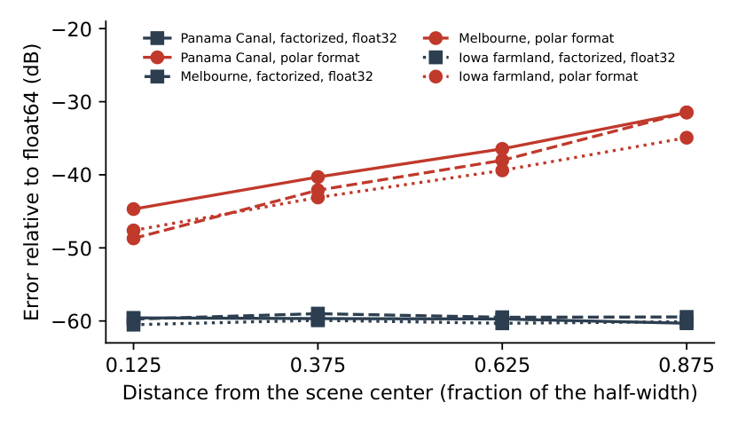

# Spotlight image formation

## Factorized backprojection

`form_image` puts pixel (i, j) at `(i - nx/2) spx e1 + (j - ny/2) spy e2` relative to the scene reference point
and applies a Taylor window (-35 dB, nbar 4) unless `window=False`. It plans and compiles on every call, an
`ImageFormer` once per antenna path; on JAX and TPU, equal plans share one program.

The image is divided recursively into tiles (three levels by default). At each level the phase history of a parent
tile is re-referenced to each child tile's center by a phase ramp, then low-pass filtered and decimated in frequency
and pulse index by a Kaiser-windowed sinc (70 dB design attenuation). At the last level the range to each pixel is
linearized about the tile center, so each final T by T tile is a product of two matrices and a per-pixel quadratic
phase correction. 

The TPU kernels fuse rotation and decimation and run the final stage on the matrix units; the CUDA kernels use
shared-memory filters and run the final stage on the tensor cores (float16, and float32 as three bfloat16 products on
compute capability 8.0 and later). CUDA and C++ use float64 geometry at every level and their float32 images agree to
about -87 dB; the JAX program and the TPU kernels compute the last level's geometry in float32.

### Tile size and range

The final stage models each tile with a plane wave plus an aperture-mean curvature term. The residual grows as the
square of the tile size and falls with range. With `T='auto'` the error of each tile size is predicted from the geometry; the larger of 32 and 16 that meets `target_db` (default -40 dB) is used, with a warning when neither does
(`ImageFormer.predicted_error_db`). Spaceborne collections keep T=32 (16 on ARM CPUs, whose four-lane vectors make the 32-pixel final stage the
slower one); CUDA float16 always uses 32. Test results
(`tests/test_accuracy.py`, 128 by 128 pixels of 0.5 m): at 1 km, T=16 gives -34.8 dB (T=32: -22.5 dB); at 4 km,
T=16 gives -47.0 dB (T=32: -35.7 dB); at 16 km, T=32 gives -47.7 dB. The prediction is within 1.3 dB of these. At
600 km both tile sizes give about -63 dB, set by errors other than the tile model.

## Exact backprojection

`ExactFormer` forms an exact backprojection on the `form_image` grid. The window, the pixel tiles with their centers, and the range bins each pulse can reach depend only on the geometry and are computed when the former is built (from the
grid's nearest point to the antenna, by projection onto the plane, to its farthest corner). Each pixel's range is
its tile center's, in float64 once per tile and pulse, plus a third-order expansion in its offset `d` from the
center: with `u` the unit vector from the antenna to the center, `r` their distance, `du = d.u` and
`D2 = |d|^2 - du^2`, `|w + d| - |w| = du + D2 / (2 r) - du D2 / (2 r^2)`; no division or square root is evaluated
per pixel. The next term is at most `h^4 / (8 r^3)` for a tile of half-diagonal `h`. Each former takes the largest
tile (32 by 32 down to 4 by 4 pixels on the CPU, 8 by 8 on CUDA) whose bound `h^4 / (2 r^3)`, with `r` the smallest
pixel-to-antenna distance, stays below 3e-4 rad of phase at the highest frequency, and warns when none does. Orbital
collections keep 32 by 32 tiles; at X band with 1 m pixels, ranges of 1 to 2 km take 8 by 8 tiles. On simulated 128 by 128 pixel scenes (cubic at 4 times, against a float64 backprojection at 64 times oversampling) the error was -67 to -68 dB from 0.5 to 20 km and at 600 km. Range profiles are kept only over the reachable bins and read with cubic
Lagrange interpolation at `upsample=8` (default) or linear interpolation at `upsample=8`. On the Umbra Panama
collection cubic interpolation measures -67.4 dB against the float64 reference (that reference's own accuracy:
against a 64 times float64 truth the regions are -77.5 to -81.7 dB), and linear -56.9 dB (`tests/test_exact.py` checks -65 and -52 dB on simulated scenes at 20 and 600 km).
The CUDA and C++ kernels implement this; on TPU, `ExactFormer` runs `backproject`'s JAX program with linear interpolation, at
four times the cubic oversampling (`upsample=32` for the default 8; linear keeps its own).

`backproject` forms the image at any points, such as `plane_points(...)` on a DEM; `rcv` makes it bistatic (`ant` is
then the transmitter) and `ref` handles a moving reference point. Its cost is pulses times points. Each pulse is
range compressed by an FFT zero-padded `upsample` times (default 8) and read with linear interpolation. Ranges are
float64 at the centers of 256-point blocks and float32 within a block, so float32 kernels stay accurate at orbital
range. The CPU kernel works in float64; `backend='tpu'` runs the JAX program.

Test results (`tests/test_bp.py`, `upsample=16`, against float64): CPU -77 to -82 dB, JAX and CUDA -72 to -76 dB,
monostatic and bistatic, at 5 and 600 km; a moving reference point matches a fixed one to -60 dB. Against a 128x
reference at 4 km (`tests/test_accuracy.py`) the error falls by 12 dB per doubling of `upsample`: -38.7 dB at 2,
-62.8 dB at 8, -87.7 dB at 32.

## Polar format

`algorithm='pfa'` resamples the data onto a rectangular wavenumber grid by chirp-z transforms and applies a 2-D FFT.
`pfa_support` chooses the raster's spectral support: `'union'` (default) keeps every pulse's band, the trapezoid
backprojection sees, with zeros where a pulse has no sample; `'inscribed'` keeps the rectangle common to all pulses,
a clean window at the cost of the bandwidth outside it (about half the range bandwidth in the ground plane of a
squinted orbital spotlight, little in the slant plane).
`pfa_guard` (default 300 m, for orbital scenes) is the margin kept free of wrap-around; small simulated scenes need
less. The polar raster is taken about the grid's range axis `e2`, which must point along the mid-aperture line of
sight in the image plane (the vendors' image grids do, whatever the squint of the collection); a grid rotated from it
degrades quickly (15 degrees on a squinted Umbra spotlight gave -5 dB against backprojection where the aligned grid
gave -27 dB) and FastSAR warns beyond 2 degrees. Backprojection takes any grid. The planar-wavefront assumption displaces scatterers away from the center: on Panama by up to 18 pixels in
azimuth and 12 in range at the corners. FastSAR removes the displacement predicted from the geometry by a final
resampling. The error is then -32.1 dB on Panama (Melbourne -33.5 dB, Iowa -35.4 dB). It grows by about 10 dB from
the inner to the outer ring around the scene center; the factorized image's error stays level:

*Error relative to the float64 reference in four rings around the scene center, for polar format and the float32
factorized image on the L4.*

### Quick look

`fastsar.quicklook` runs polar format on a cut of the collection, in a form whose cost follows the picture and not
the collection ([processing-chain.md](processing-chain.md#quick-look)). The cut is the central run of frequency
samples and the central run of pulses whose bands are 0.96 over the pixel spacings. Contiguous runs keep the sample
and pulse spacings, so the unambiguous extents stay those of the collection. The grid lies in the slant plane with
its range axis along the mid-aperture line of sight. The stages:

1. Range. Each pulse is weighted, transformed to a range profile, cut to the bins the picture spans (a raised-cosine
   edge beyond them) and transformed back, to a spectrum sampled 1.5 times finer than the gate needs. A 16-tap
   Kaiser-windowed sinc reads it at the range wavenumbers of the raster. A file whose frequency step leaves 34 km
   unambiguous for a 2 km swath (the Umbra collection below) is cut to the swath here.
2. Azimuth. The pulses of each range wavenumber are transformed, cut to the picture's azimuth extent and
   transformed back at the pulse spacing that extent needs. The cut is set in meters for each range wavenumber:
   the bins of that transform scale with the wavenumber, by 5% and more across a wide band, and a cut set in bins
   lets the low end of the band wrap content from beyond the picture into its far edge. The same kernel reads the
   result at the raster's azimuth wavenumbers, at positions taken from the pulses' own spacing in the tangent of
   the look angle, which is uneven by 1.4% on Panama. The pulses are not resampled separately.
3. The raster's two-dimensional transform, cut to the picture. With `correct=False` this is the image.
4. With `correct=True` the transform is taken on a raster padded to twice the sampling and read at each pixel's
   apparent position with a 6-tap Lanczos kernel, as `algorithm='pfa'` does.

The gates leave the picture inside 0.65 of each transform's period, the part the kernel reads to -58 dB, and a
picture is cut to 0.92 of an unambiguous extent that the tasked area exceeds. On the CPU each of the first two
stages is one pass per block of rows on a thread pool, every transform runs along the rows of its array, and the
kernels read their weights from polyphase tables of 2048 positions per sample. Nothing is compiled per geometry.

Against exact backprojection of the same cut history on the same grid (`ExactFormer`, the same Taylor window; the
rms of the complex difference over that of the exact image, with one complex gain fitted), the corrected image
measures -42.1, -43.0 and -43.1 dB at 1024, 2048 and 4096 pixels on the Umbra collection of the table in
[performance.md](performance.md#quick-look), -41.0, -42.3 and -41.0 dB on the first Capella collection, -41.6 and
-44.0 dB at 1024 and 2048 pixels on the second, and -41.6, -42.7 and -42.2 dB on the Panama history. The fitted
gain is 0.997 to 0.998, so the image also has backprojection's scale.

At full resolution over several kilometers the corners show polar format's own limit, a defocus that the
displacement correction does not remove. On the Panama grid of 12,206 by 8,808 pixels, patches of 256 by 256
pixels measure -61.3 dB at the center and -22.9, -40.8, -41.1 and -22.4 dB at the corners, where
`algorithm='pfa'` measures -35.8 dB and -22.8, -37.2, -34.9 and -22.4 dB. On the 211 megapixel picture of the
first Capella collection (0.41 m pixels over 6.0 by 3.8 km) the center measures -68.1 dB and the corners -13.0,
-27.5, -28.8 and -13.0 dB. The phase that planar wavefronts leave over the aperture and the band for a scatterer
at those places, once its linear part (the displacement) is taken out, predicts -13.0, -28.3, -29.2 and -13.1 dB
there (1.3 rad at most) and -22.6 dB at the two worse Panama corners (0.42 rad): the error is the algorithm's and
not the resampling's. `quicklook` computes that estimate for each picture (`corner_error`) and adds a note when it
passes -30 dB; `form_cphd` forms such corners exactly. The estimate is of the defocus, and it gives the complex
error where the scene is a small part of the range, as from orbit (0.6% here). On a simulated scene 358 m deep at
2 km the amplitudes at the corners follow it (-20 to -23 dB for -19 dB) and the complex error is -6 to -10 dB,
the same for `algorithm='pfa'`: the phase of the corrected image is not held there.

Left uncorrected (`correct=False`), the image carries a phase that varies over the scene and the scatterers are
displaced: by up to 4.6 by 3.3 pixels at the corners of the 2048-pixel picture of the first Capella collection
(2.1 by 1.5 pixels measured on boxes of 512 pixels at the corners), 4.1 pixels in range on the Umbra picture, and
21 pixels in range on the picture at 84 degrees of grazing, whose slant-range pixel is 0.29 m. The amplitude image
then agrees with the exact one to -4 to -8 dB over the whole picture, which is the displacement.

## Wide-angle and circular apertures

Factorized backprojection makes no small-angle assumption and forms wide-angle and circular collections. Test
results (`tests/test_wide_angle.py`): 256 by 256 images at the resolution of 10, 45, 120 and 360 degree apertures (X
band, 1.5 GHz, pixels of 72 to 6 mm) agree with exact backprojection to -53.1, -62.2, -63.8 and -65.2 dB.

## Autofocus

`autofocus.autofocus` runs phase gradient autofocus (PGA) along azimuth on a factorized backprojection image,
first multiplied by `exp(-1j * deramp_phase(...))` so each pulse falls in one azimuth bin. The brightest pixel of
each range line is centered, the lines with the highest peak-to-mean intensity are windowed, and the phase
difference between adjacent bins is estimated jointly, with a window that narrows as the image focuses. The
estimate is mapped to pulses, the history corrected and the image re-formed, twice by default.

Test results (`tests/test_autofocus.py`, 128 by 128 pixels of 0.5 m, 40 targets over 3,000 clutter scatterers at
5 km; error against the error-free image, residual rms without constant and linear terms):

- quadratic, 5.3 rad peak: -2.7 dB before, -30.1 dB after, residual 0.037 rad
- fifth-order polynomial, 4.1 rad peak: -6.8 dB before, -30.2 dB after, residual 0.036 rad
- low-pass random walk, 3.0 rad peak: -0.2 dB before, -30.3 dB after, residual 0.036 rad

On the error-free image the procedure changes the image by -30.1 dB, a floor set by clutter and by scatterers
sharing a range line. It needs azimuth pixels finer than the resolution and a bin spacing, 1/(nx spx), fine enough
to follow the phase error. It is tested on simulated images only.
